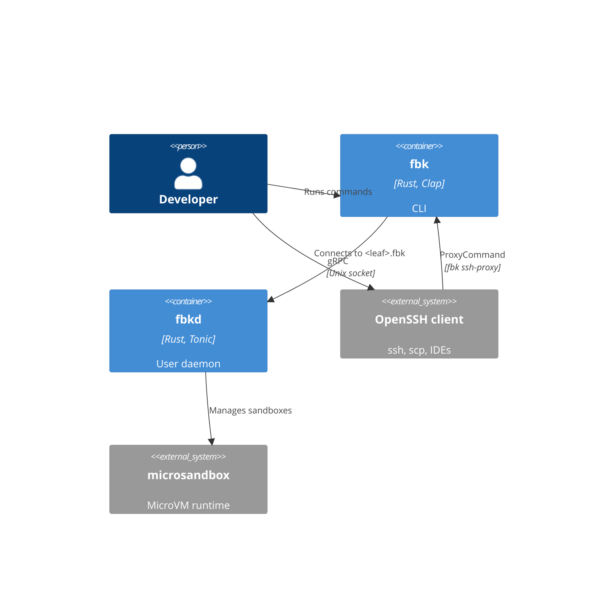
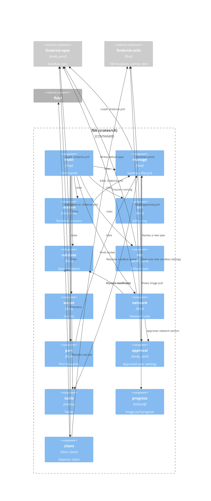
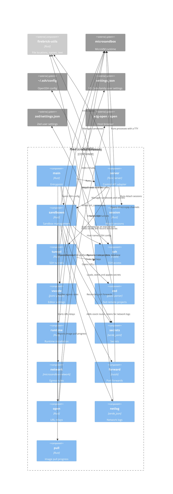

# Building block view

## Level 1 - Building blocks

- `fbk` - CLI that sends commands to the daemon, attaches the terminal to
  sandbox sessions and tunnels SSH connections to sandboxes. It starts the
  daemon when the daemon isn't running.
- `fbkd` - Daemon that manages the lifecycle of the sandboxes and sessions,
  provisions the SSH keys and writes the SSH config for the sandboxes.

The CLI and daemon speak gRPC (`crates/proto/proto/daemon.v1.proto`) over the
unix socket `$XDG_RUNTIME_DIR/fbkd.sock`. The workspace is a Cargo workspace
with five crates: `firebrick-cli`, `firebrick-daemon`, `firebrick-proto`,
`firebrick-spec` and `firebrick-utils`. The `firebrick-proto` crate generates
the gRPC client and server code from the proto file, and the CLI and daemon both
depend on it.

## Level 2 - CLI

- `main` - Parses the `start`, `stop`, `ls`, `rm`, `run`, `validate`, `init`,
  `secret set`, `secret ls`, `secret rm`, `network allow`, `network deny`,
  `network policy enable`, `network policy disable`, `network enable`, `network
  disable`, `network log`, `port forward` and `port rm` commands, and the hidden
  `ssh-proxy` command. The argument of `port forward` is parsed with
  `PortMapping`'s parser, and that of `port rm` as a port from 1 to 65535.
  `validate`, `init` and `--version`, which prints the package version, run
  without the daemon. `start`, `run` and every `network` subcommand that changes
  the network settings take `--yes`, which approves changed mounts and network
  settings without asking; `network log` changes nothing and doesn't take it.
  `run` takes the command and its arguments as one trailing list, so options
  after the command, such as `--yes`, go to the command.
- `client` - Connects to the daemon socket. When nobody listens, it removes a
  stale socket, spawns `fbkd` from next to the `fbk` binary (or from `PATH`) and
  waits at most 5 seconds for the socket.
- `manage` - Resolves the sandbox spec for the working directory and starts,
  stops, lists and removes sandboxes. Without `.firebrick.yml`, it names the
  sandbox after the full working directory path. Before it creates a sandbox, it
  has `approval` check the resolved mounts and the network section. `ls` prints
  the name, status and host name of each sandbox as a table, or as a JSON array
  with `--format json`.
- `session` - Runs a command in the sandbox through the `Attach` stream. It
  makes sure the sandbox runs first, puts the terminal in raw mode and forwards
  input, output and window resizes.
- `ssh` - Tunnels SSH protocol bytes between stdin/stdout and the `SshTunnel`
  stream. The generated SSH config uses it as `ProxyCommand`.
- `secret` - Sends a secret to the daemon with `SetSecret`. With `--from-stdin`,
  it reads the value from stdin and removes one trailing line ending. With
  `--scope sandbox`, `secret set` and `secret rm` send the name of the working
  directory's sandbox, resolved like `fbk stop` without a name; the default
  `--scope global` sends none. `secret ls` prints the names, scopes (`global` or
  the sandbox name) and allowed hosts from `ListSecrets` as a table or, with
  `--format json`, as a JSON array. `secret rm` removes a secret with
  `RemoveSecret`. It warns about sandboxes the daemon couldn't add the secret to
  or remove it from.
- `network` - Keeps the network settings in `.firebrick.yml` and the sandbox in
  sync. It validates the rules, applies the change to the network section of the
  spec in the working directory and writes the file, before it sends the whole
  section to the daemon with `UpdateNetwork`. `allow` and `deny` add rules to
  one list and remove them from the other, without duplicates. `policy` sets
  `enforce`, which decides whether the rules are enforced. `enable` and
  `disable` set `enabled`, which decides whether the sandbox has a network
  device at all; a missing `enabled` counts as `true`. Without `.firebrick.yml`,
  it writes `default_spec` with the name `manage` would pick, including a legacy
  name, plus the change. An invalid file is reported like `validate` reports it,
  and nothing changes. When the network section didn't change, it leaves the
  file alone but still asks the daemon, so the sandbox catches up with the file.
  Before it sends the section, it has `approval` compare it with the approved
  section with the change applied, and asks about any other difference.
  `NOT_FOUND` from the daemon means the sandbox doesn't exist yet, so the file
  alone is enough. It warns when `allow` or `deny` leave `enforce` off. `log`
  only reads: it resolves the working directory's sandbox like `fbk stop`
  without a name, asks the daemon for its record with `ListNetworkActivity` and
  prints the entries in the daemon's order as a table with the destination, the
  kind (`dns`, `tcp` or `udp`), the ports, the count, the last time it was seen
  in the local time zone and the policy (`allowed` or `denied`). It removes
  control characters from the destinations, because they come from inside the
  sandbox. It doesn't touch `.firebrick.yml` or `approval`. An empty record
  prints `No network activity recorded for <sandbox> yet.`, `NOT_FOUND` that the
  sandbox doesn't exist, and `FAILED_PRECONDITION` that the sandbox was created
  before network logging and how to turn it on.
- `approval` - Keeps the `mounts` and `network` settings the user approved per
  workspace in `approved.yml` in the config directory, prints the difference
  with the settings a command is about to apply and asks `Apply these changes?
  [y/N]` (see
  [Approving spec changes](08-crosscutting-concepts.md#approving-spec-changes)).
- `port` - Forwards a host port to the working directory's sandbox with
  `ForwardPort`, or removes a forward with `RemovePort`, and records the change
  in `.firebrick.yml` with `firebrick_spec::add_port` and `remove_port`. It
  resolves the sandbox name like `fbk start`, prepares the edited file text
  before it contacts the daemon, and writes the file only after the daemon
  accepted the change; without a `.firebrick.yml` it creates one with the
  resolved name. When the sandbox doesn't exist yet, it skips the RPC and only
  writes the file. It reports an invalid spec like `validate`, a
  `FAILED_PRECONDITION` as `couldn't forward localhost:<port>: <reason>` and a
  `NOT_FOUND` as `port <port> isn't forwarded for sandbox <name>`. See
  [Forwarding a port](06-runtime-view.md#forwarding-a-port).
- `table` - Renders rows as a bordered table with `ratatui` into an in-memory
  buffer and returns it as plain text lines
  ([ADR 0003](decisions/0003-render-cli-tables-with-ratatui.md)).
- `progress` - Shows the image pull progress from the `StartSandbox` stream on
  stderr: a progress bar made with `indicatif` with the downloaded and total MiB
  and a percentage when stderr is a terminal, and otherwise `Pulling image
  <ref>...` and `Pulled image <ref>`. It shows nothing when no progress arrives,
  and clears an unfinished bar when the start fails
  ([ADR 0024](decisions/0024-stream-image-pull-progress-from-startsandbox.md)).
- `validate` - Checks `.firebrick.yml` and reports problems as
  `file:line:column: error: message`.
- `init` - Writes `firebrick_spec::default_spec` as YAML to `.firebrick.yml` in
  the working directory, named after the working directory's leaf with
  `firebrick_utils::sanitize_label`, the rule that also makes the SSH host
  names. It refuses to replace an existing file unless `--force` is passed.

## Level 2 - Daemon

- `main` - Sets up logging to stdout and to a daily log file in
  `$XDG_STATE_HOME/firebrick`, exits when the socket is already in use, makes
  sure the microsandbox runtime and the SSH keys exist, makes the microsandbox
  `db` directory readable by the user only, syncs the SSH config and serves the
  API until `SIGINT` or `SIGTERM`. Before serving, `server` reopens the port
  forwards of the sandboxes that are running, and when it stops, their listeners
  close.
- `server` - Adapts `SandboxManagementService` to the modules below: it converts
  each request into plain values, calls `sandboxes`, `session` or `tunnel`, and
  converts the result into a response. It converts requested resources and
  volumes to vCPUs and MiB, falling back to the defaults from `firebrick-spec`
  (for the Docker volume also when the request's `docker` size is empty), and
  rejects invalid values with `INVALID_ARGUMENT`. It parses the network rules of
  a `StartSandbox` or `UpdateNetwork` request with `firebrick-spec` and rejects
  an invalid rule with `INVALID_ARGUMENT`, also when the sandbox already exists.
  It rejects a port outside 1 to 65535 or a host port that is listed twice with
  `INVALID_ARGUMENT`. `ListNetworkActivity` turns a sandbox's record into one
  entry per DNS name and per connection address and protocol, sorted by last
  seen, newest first, and evaluates the sandbox's current rules for each with
  `network::allows_host`: domain rules for a DNS entry, IP and CIDR rules for a
  connection, and `allowed` for every entry when the rules aren't enforced. This
  is `fbkd`'s evaluation, not microsandbox's own decision. `StartSandbox` is a
  server-streaming RPC: `server` runs the start in a task of its own, so it
  finishes when the client disconnects, streams the image pull progress and ends
  the stream with the open and failed forwards, or with the error status. It
  maps the `SandboxError` of `sandboxes` to gRPC status codes in one place. It
  refuses to start when the socket already exists, gives the socket mode `0600`
  after binding it and removes it on shutdown. It only hands a connection to
  tonic when the peer's UID, read with `SO_PEERCRED`, is the daemon's own UID or
  root (see
  [Securing the daemon socket](08-crosscutting-concepts.md#securing-the-daemon-socket)).
- `sandboxes` - Manages sandboxes on top of microsandbox, without knowing about
  gRPC. It creates sandboxes from the requested image (or the default image)
  with the requested vCPUs and memory, mounts the workspace read/write at
  `/workspaces/<leaf>`, bind mounts the extra `mounts` of the request the same
  way (owner `1000:1000`, host permissions mirrored, read-only when asked) after
  rejecting a relative host path, an invalid guest path, or one that equals the
  workspace path or `/var/lib/docker` with `INVALID_ARGUMENT`, attaches a
  sandbox-owned ext4 disk of the requested size at `/var/lib/docker` (see
  [ADR 0015](decisions/0015-give-each-sandbox-a-docker-data-disk.md)), applies
  the egress rules with the `network` module and adds the global secrets, with
  the sandbox's own sandbox-scoped secrets in their place. The disk survives
  stops and restarts, and microsandbox deletes it when the sandbox is removed.
  With `init` on, it hands PID 1 to the image's `/sbin/init`. When that fails
  because the image has no init, it removes the half-created sandbox and returns
  `FAILED_PRECONDITION` with a hint to set `init: false`. A pull of an image
  that doesn't exist returns `NOT_FOUND`, and one whose registry can't be
  reached `UNAVAILABLE`, both naming the image. Invalid values are rejected
  before it creates anything. When it creates or starts a sandbox, it uses the
  `mise` module to trust the mise config files at the workspace root and run
  `mise install`, unless the sandbox's `firebrick.mise` label, stored at create
  time, turns mise off (see
  [Starting a sandbox](06-runtime-view.md#starting-a-sandbox)). It starts,
  stops, gets, lists and removes sandboxes, gives each sandbox a unique SSH host
  name, regenerates the SSH config, the editor settings and Zed's remote
  projects after every start and remove and when the daemon starts, and connects
  to a sandbox by name or host name. `GetSandbox` returns the sandbox's working
  directory, which is the workspace mount path, as `workspace_path`, and the
  host directory bind-mounted there, canonicalized, as `workspace_host_path`.
  Both are empty for a sandbox without a workspace. The CLI compares
  `workspace_host_path` with the working directory before it uses an existing
  sandbox. A failed sync only logs a warning. `SetSecret` stores a secret and
  adds it to the sandboxes in its scope: a global secret to the existing
  sandboxes firebrick created, except the ones with a sandbox-scoped secret with
  that name, and a sandbox-scoped secret to its sandbox only, which must exist.
  `ListSecrets` returns the names, scopes and allowed hosts, sorted by name and
  then scope with the global secret first, never the values. `RemoveSecret`
  removes a secret from the same sandboxes and then from the store, keeps it in
  the store when a sandbox fails so the removal can be retried, and returns
  `NOT_FOUND` for an unknown name or sandbox. A sandbox that loses its
  sandbox-scoped secret gets the global one with that name back. Removing a
  sandbox removes its sandbox-scoped secrets from the store (see
  [Secret scopes](08-crosscutting-concepts.md#secret-scopes)). A lock around the
  secret store makes sure a sandbox that is being created can't miss a secret
  that is being set. It stores a sandbox's port mappings in the
  `firebrick.ports` label (`3000:3000,8080:5173`), updates it from each
  `StartSandbox` that carries ports, also for a running sandbox (as a
  `next_start` change, so the VM keeps running), and keeps it when a request
  carries none. Once a sandbox runs after `StartSandbox`, or after `SshTunnel`
  started it, it hands the stored ports to `forward`; `StopSandbox` and
  `RemoveSandbox` close the sandbox's forwards. `UpdateNetwork` replaces the
  network settings of an existing sandbox, the network switch and the egress
  rules, by recreating it from a disk snapshot, with the settings it reads from
  the sandbox's stored config (see
  [Updating the network rules](06-runtime-view.md#updating-the-network-rules)
  and
  [ADR 0021](decisions/0021-recreate-sandboxes-from-a-disk-snapshot-to-change-their-network-rules.md)).
  It skips a sandbox whose `firebrick.network` label already records the
  settings (`disabled` for a sandbox without a network device, whatever its
  rules) and refuses a paused one. It closes the forwards while it stops the
  sandbox and reopens them when the sandbox runs afterwards. The recreated
  sandbox keeps its extra mounts and its labels, including `firebrick.ports`.
  Creating and recreating a sandbox share one builder chain, which also sets
  that label. A lock per sandbox name, held by start, stop, remove, connect,
  `ForwardPort`, `RemovePort` and `UpdateNetwork`, keeps those operations from
  interleaving with a recreate; a lock is dropped when no task holds or waits
  for it. `ForwardPort` adds one mapping to the stored ports, replacing the one
  with the same host port, and `RemovePort` removes the mapping of a host port,
  or returns `NOT_FOUND` when it isn't stored. For a running sandbox, both first
  reconcile its forwards with the new list; when the requested forward can't be
  opened, also when it was stored already, they reopen the old forwards and
  return `FAILED_PRECONDITION` with the reason, without changing the label. For
  a stopped sandbox they only update the label, and the forward opens on the
  next start. Both return whether the sandbox runs. They hold the sandbox's
  lock, so they can't interleave with a recreate by `UpdateNetwork`, and the
  ports lock while they read, reconcile and store the ports. `StartSandbox`,
  `Attach`, `SshTunnel` and an `UpdateNetwork` of a running sandbox make sure
  the sandbox's URL relay runs, through `open`; `StopSandbox`, `RemoveSandbox`
  and recreating the sandbox forget it. The shared builder chain also adds the
  vsock route of the sandbox's network log through `netlog`, so created and
  recreated sandboxes get it, also when the original had none. Before it creates
  a sandbox, starts one that has the route (also through `SshTunnel`) or
  recreates one, it makes `netlog` listen on the sandbox's socket; `fbkd` does
  the same for every sandbox with the route when it starts. `RemoveSandbox`
  deletes the socket and the record. `SandboxManager::network_activity` returns
  a sandbox's record from `netlog` with its rules from the `firebrick.network`
  label (`network::rules_of`), or `FAILED_PRECONDITION` when the sandbox has no
  network log route.
- `pull` - Turns microsandbox's `PullProgress` events into pull updates: it adds
  up the downloaded bytes per layer, takes the total from the manifest, and
  reports at most one update every 100 ms, one for each layer that finishes and
  a final one when the pull completes. A pull without layer downloads, because
  the image is cached, reports nothing.
- `session` - Runs an `Attach` session: rejects invalid window sizes with
  `INVALID_ARGUMENT`, starts the command with a TTY in a running sandbox and
  forwards input, resizes, output and the exit code between the gRPC stream and
  the process until either side ends.
- `tunnel` - Serves an `SshTunnel` connection with microsandbox's SSH server
  over an in-memory pipe, copying bytes in both directions until the SSH session
  closes. `sandboxes` boots the sandbox when needed.
- `forward` - Forwards host loopback ports to a sandbox's loopback
  ([ADR 0019](decisions/0019-forward-ports-through-the-ssh-servers-direct-tcpip.md)).
  `Forwards::apply` reconciles a sandbox's open forwards with a list of
  mappings: it closes the ones that aren't listed, then opens the new ones, and
  leaves unchanged ones and their connections alone. Each forward listens on
  `127.0.0.1:<host>` and, when the host has IPv6 loopback, on `[::1]:<host>`;
  never on other addresses. Before it listens, it checks that no socket listens
  on the port at the wildcard address, because on macOS a loopback bind succeeds
  next to such a listener. A host port that is in use, by another process or
  another sandbox's forward, or that needs privileges is logged as a warning and
  reported, and the next `apply` tries it again. `Forwards::close` closes the
  listeners and their connections and returns once the ports are free. Each
  accepted connection goes through a `Connector`; `SshConnector` opens a
  `direct-tcpip` channel to `127.0.0.1:<guest>` over one SSH session per
  sandbox, which it opens on first use and reopens when it has closed; opening a
  session to one sandbox doesn't hold up connections to the others. The session
  runs microsandbox's SSH server over an in-memory pipe with keys generated for
  that session and no inactivity timeout, so forwards stay open while the
  sandbox runs. When nothing listens on the guest port, the host connection is
  closed and logged at `debug`. `CallbackForwards` holds the on-demand forwards
  of one sandbox that `open` uses for OAuth callback ports (see
  [ADR 0030](decisions/0030-forward-oauth-callback-ports-when-opening-a-url.md)):
  `CallbackForwards::ensure(port)` forwards `localhost:<port>` to the same port
  in the sandbox through the same listeners and `Connector`, or reuses the open
  forward of the port and resets its idle timer. A port that the sandbox's
  configured `Forwards` already map to the same guest port needs no forward of
  its own; `SandboxManager` shares its `Forwards` with `Relays` for this check.
  A forward closes after 10 minutes without open or new connections, and
  dropping `CallbackForwards` closes them all. A host port it can't listen on is
  logged as `couldn't forward localhost:<port> for sandbox <name>: <error>` and
  fails `ensure`.
- `open` - Opens http and https URLs from a sandbox in the browser on the host
  (see
  [ADR 0026](decisions/0026-relay-urls-to-the-host-through-an-exec-stream.md)
  and
  [Opening a URL on the host](06-runtime-view.md#opening-a-url-on-the-host)).
  `Relays::ensure` starts the relay of a connected, running sandbox unless it
  already has one: an inline `sh -c` script, run with `exec_stream_with` as the
  image's user, that creates `/tmp/.firebrick` (mode `0700`) and the FIFO
  `/tmp/.firebrick/open.fifo` when they're missing, keeps the FIFO open itself
  and echoes each line written to it. A registry keyed by sandbox name holds at
  most one relay per sandbox; an entry goes away when its exec stream ends or
  when `Relays::forget` is called because the sandbox stopped or is being
  recreated, so the next `StartSandbox`, `Attach`, `SshTunnel` or
  `UpdateNetwork` of a running sandbox starts a new relay. `fbkd` splits the
  relay's output into lines and checks each one: it must start with `http://` or
  `https://` in any case, have no whitespace or control characters, be at most 8
  KiB and parse with the `url` crate, which reads the host the way a browser
  does (`http://2130706433/` is `127.0.0.1`). It rejects `localhost`,
  `*.localhost` and loopback, private, shared, link-local, unique local and
  unspecified IP addresses. When the sandbox enforces egress rules, read from
  its `firebrick.network` label with `network::rules_of`, the host must also
  pass `network::allows_host`, which matches the rules the way microsandbox
  does: deny rules first, then allow rules, else deny. Domain rules only match
  host names and IP rules only IP addresses, because `fbkd` doesn't resolve
  names. A sandbox whose label can't be read, or one with a network policy that
  predates the label, opens only forwarded loopback URLs. At most 5 URLs per
  sandbox open within 10 seconds. `fbkd` opens the URL as the `url` crate
  serializes it through an `Opener`; `HostOpener` runs `xdg-open <url>` on Linux
  and `open <url>` on macOS with `tokio::process`, without a shell, and doesn't
  wait for it; tests pass an opener that records the URLs. A rejected line is
  logged at `warn` without the URL, with the reason. A relay that can't start or
  exits with an error is logged as a warning with its stderr, and an opener that
  fails is logged as a warning; neither fails the request. Before it opens a
  URL, `fbkd` forwards its loopback ports into the sandbox with the relay's own
  `CallbackForwards`, which use a `SshConnector` of their own: the port of the
  URL's own host when that is `localhost`, `127.0.0.1` or `[::1]` with an
  explicit, non-zero port, and the same for the port of a percent-decoded `http`
  `redirect_uri` query parameter. Such a loopback URL skips the local host and
  egress checks, because it reaches the sandbox, and opens only when its forward
  is open; a busy `redirect_uri` port is logged as `opening a URL from sandbox
  <name> without forwarding its callback port <port>` and the URL still opens.
  The forwards close when the relay ends, when `Relays::forget` stops the relay
  task, or after they're idle.
- `netlog` - Records the domains and IP addresses a sandbox contacts, as the
  logger in the `firebrick-base` image reports them (see
  [ADR 0038](decisions/0038-record-network-activity-with-a-guest-logger-on-vsock.md)
  and
  [Recording network activity](06-runtime-view.md#recording-network-activity)).
  `NetLogs::add_route` adds a stream route from guest vsock port `52000` to
  `$XDG_RUNTIME_DIR/firebrick/netlog/<sandbox>.sock`. Without an absolute
  `XDG_RUNTIME_DIR` there are no sockets: unlike the daemon socket, they never
  fall back to the shared temp directory, where another user could create the
  directory first and take them over. `fbkd` logs that once when it starts. When
  the path doesn't fit in a unix socket address (108 bytes), it adds no route
  either and logs a warning, because microsandbox would refuse to boot the
  sandbox. `NetLogs::listen` binds the socket unless `fbkd` already listens on
  it, replacing a listener that stopped, for example because it panicked: it
  creates the directory with mode `0700`, leaves a socket that another process
  answers on alone, and removes a stale socket file first. A socket that can't
  be bound is logged as an error and the sandbox starts without a record. File
  reads and writes run off the async runtime. Each line the guest writes is
  untrusted: a line longer than 4 KiB, invalid JSON, an unknown `kind`, a name
  that isn't a valid DNS name, an invalid IPv4 address or port 0 is dropped, and
  the connection stays open. A sandbox gets at most 4 connections at a time;
  further ones are closed. Warnings about the guest's input and about failures
  on the host, such as a record that can't be written, are each logged at most
  once a minute per sandbox, so the guest can't hide host failures. A panicking
  connection or listener is logged as an error. The valid events are aggregated
  per destination: a DNS entry per name (lowercase, without a trailing dot) with
  its resolved IPv4 addresses, and a connection entry per address and protocol
  with its ports, each with a count and the first and last time `fbkd` received
  it (the guest's own timestamp is ignored). A record holds at most 10,000
  destinations, after which new ones are dropped with one warning while known
  ones keep updating, and at most 64 addresses or ports per entry. The record is
  written to `$XDG_STATE_HOME/firebrick/network/<sandbox>.json` (falling back to
  `~/.local/state/firebrick/network`) with `write_private`, at most once a
  second while it changes, and a last time when `fbkd` shuts down
  (`NetLogs::close`). A corrupt record file is logged as a warning and replaced
  by a new, empty record. `NetLogs::record` returns a sandbox's entries.
  `NetLogs::remove` stops the listener, waits until it can't write anymore, and
  then deletes the socket and the record, so a removed sandbox's record can't
  come back.
- `runtime` - Makes sure the microsandbox runtime (`msb` and `libkrunfw`)
  matches the runtime archive embedded in `fbkd` at build time, so it never
  needs network access. It extracts the archive when no runtime is installed,
  and replaces a runtime in the microsandbox home whose `msb` has another
  version. An explicitly configured runtime with another version, or a partial
  installation, is an error.
- `secrets` - Validates secrets, keeps them in `secrets.yml` (mode `0600`) and
  adds them to sandboxes through microsandbox's secrets feature: the guest sees
  a placeholder such as `$MSB_GH_TOKEN`, and microsandbox's TLS proxy puts the
  real value in requests to the secret's allowed hosts. It knows the default
  allowed hosts for well-known names such as `GH_TOKEN` and `ANTHROPIC_API_KEY`
  ([ADR 0004](decisions/0004-store-secrets-in-a-private-file.md)). Each secret
  is global or belongs to one sandbox, and a name is unique within a scope
  ([ADR 0022](decisions/0022-scope-secrets-per-sandbox.md)).
- `network` - Turns the `network` section of a spec into the network settings of
  a sandbox that is being created. With `enabled: false`, it calls
  microsandbox's `disable_network()`, which removes the network device and sets
  a deny-all policy, and ignores `enforce`, `allow` and `deny`: there is no
  traffic to intercept, so it sets up no TLS interception or deny page. Stored
  secrets are still added; they don't bring the device back. `fbk run`, the SSH
  tunnel and port forwards keep working, because they go through microsandbox's
  agent channel instead of the guest network. Without `enforce`, it leaves the
  sandbox with microsandbox's default policy. With `enforce`, it builds a policy
  of all deny rules, then all allow rules, then microsandbox's DNS rule, with
  deny as the default for egress. Host names map to a `Domain`, `*.domain` to a
  `DomainSuffix`, and IP addresses and CIDR ranges to a `Cidr`. It also turns on
  TLS interception for port 443 and microsandbox's HTTP deny response, whose
  body names the host and `fbk network allow <host>`
  ([ADR 0018](decisions/0018-enforce-egress-with-microsandboxs-network-policy.md)).
- `ssh` - Creates the ed25519 client and host keys, pins the host key for
  `*.fbk` in a `known_hosts` file, picks a unique `<leaf>.fbk` host name per
  sandbox (stored in the `firebrick.hostname` label, with the leaf sanitized by
  `firebrick_utils::sanitize_label`), and writes the generated SSH config that
  `~/.ssh/config` includes.
- `vscode` - Keeps `remote.SSH.remotePlatform` in the user `settings.json` of VS
  Code, VS Code Insiders, Cursor and VSCodium in sync with the sandbox host
  names, so Remote-SSH doesn't ask for the platform. Every host maps to
  `"linux"` and stale `*.fbk` keys are removed; other keys, comments and
  trailing commas stay as they are
  ([ADR 0010](decisions/0010-edit-vs-code-settings-with-jsonc-parser.md)). The
  settings live under `$XDG_CONFIG_HOME` (default `~/.config`) on Linux and
  `~/Library/Application Support` on macOS; `FIREBRICK_EDITOR_CONFIG_ROOT`
  overrides both, which the `vm-tests` use to stay away from the developer's own
  settings. An editor whose `User` directory doesn't exist is skipped, and a
  missing `settings.json` is created. A file is left unchanged with a warning
  when it isn't JSON with comments and trailing commas (what VS Code accepts),
  when `remote.SSH.remotePlatform` isn't an object or appears more than once, or
  when it's a symlink to a missing file. Writes go to a temporary file that is
  renamed onto the file a symlink points to, so a symlinked settings file stays
  a symlink. The reading, writing and parse options live in `settings_file`,
  which `zed` shares.
- `zed` - Keeps the `ssh_connections` array in Zed's user `settings.json` in
  sync with the sandboxes, so they show up in Zed's Remote Projects. Each
  sandbox with a host name gets an entry with `host`, the sandbox name as
  `nickname`, and one project whose `paths` hold the workspace path (no projects
  for a sandbox without one). The daemon owns the entries whose `host` ends in
  `.fbk`: it adds missing ones, rewrites the ones whose value differs and
  removes stale and duplicate ones; other entries, keys, comments and trailing
  commas stay as they are
  ([ADR 0011](decisions/0011-own-the-anvil-entries-in-zeds-ssh-connections.md)).
  The file is `zed/settings.json` under `$XDG_CONFIG_HOME` (default `~/.config`)
  on Linux and under `~/.config` on macOS, the same as Zed's own config
  directory; `FIREBRICK_EDITOR_CONFIG_ROOT` overrides both. When the `zed`
  directory doesn't exist, Zed is skipped; a missing `settings.json` is created.
  The file is left unchanged with a warning when it can't be parsed, when
  `ssh_connections` isn't an array, appears more than once or has an entry that
  isn't an object, or when it can't be read or written.

## Shared crates

- `firebrick-proto` (`crates/proto`) - The gRPC client and server code that
  `tonic-prost-build` generates from `crates/proto/proto/daemon.v1.proto`. The
  CLI and daemon re-export it as their `api` module. It also converts a `Mount`
  into a `firebrick_spec::MountSpec`, so the CLI approves the mounts the way the
  daemon creates them.
- `firebrick-spec` (`crates/spec`) - Parses `.firebrick.yml` into a
  `SandboxSpec` with a `name`, an optional `image`, optional `init` and `mise`
  flags, optional `resources` (`cpu`, `memory`), `volumes` (`docker`, the size
  of the Docker data disk), an optional `network` section (`enabled`, default
  `true`, `enforce`, default `false`, and the `allow` and `deny` rules), an
  optional `ports` list and optional `mounts` (`host`, `guest` and `readonly`,
  default `false`), rejects unknown fields and reports the line and column of a
  problem. A `PortMapping` in `ports` is written like Docker Compose: `3000`
  forwards host port 3000 to guest port 3000, and `"8080:5173"` host port 8080
  to guest port 5173. Ports outside 1 to 65535, other forms and a host port that
  appears twice are reported at the entry. `add_port` and `remove_port` add,
  replace or remove one entry in the text of a spec file: they edit only the
  lines of the top-level `ports` block, so comments and formatting elsewhere
  stay, append a `ports` key when there is none, write `ports: []` when the last
  entry goes, and rewrite a flow list such as `[3000]` as a block list. They
  parse the result before returning it. `with_port` replaces or adds a mapping
  by host port; the daemon uses it for the stored ports too. `guest_mount_path`
  checks a mount's `guest` the way microsandbox does: an absolute path other
  than `/`, without `..`, `:`, `;` or `,`. It normalizes the path (no `.` parts
  or trailing slash), and each normalized path may appear only once. The daemon
  uses the same check. The CLI resolves each mount's `host` against the spec
  file's directory, expanding `~` to `$HOME` and `~user` to that user's home
  directory
  ([ADR 0020](decisions/0020-look-up-user-home-directories-with-nix.md)), to the
  canonical path of an existing directory before it sends `StartSandbox`.
  `NetworkRule` parses a rule: a host name, `*.` plus a domain of at least two
  labels, an IPv4 or IPv6 address or a CIDR range. `*` alone, other wildcards,
  URLs, ports and paths are invalid. It owns the defaults
  (`ghcr.io/wmeints/firebrick-base:v<version>`, `init: true`, `mise: true`, 2
  vCPUs, `4 GiB` of memory, a `20 GiB` Docker volume in
  `VolumesSpec::default()`) and `parse_size_mib`, which reads memory and volume
  sizes in `Mi`/`MiB` or `Gi`/`GiB`. The CLI and daemon both use them.
  `NetworkSpec::allow` and `NetworkSpec::deny` move rules between the lists,
  `NetworkSpec::is_enabled` reads `enabled` with its default, and `to_file`
  writes a spec back as YAML, leaving out unset fields.
- `firebrick-utils` (`crates/utils`) - Well-known paths: the daemon socket
  (`$XDG_RUNTIME_DIR/fbkd.sock`), the log directory
  (`$XDG_STATE_HOME/firebrick`), the SSH directory
  (`$XDG_DATA_HOME/firebrick/ssh`) and the secrets file
  (`$XDG_DATA_HOME/firebrick/secrets.yml`), each falling back to `HOME`. The
  log, SSH and secrets paths are `None` when neither variable is an absolute
  path, never the temp dir, and `missing_dir` returns the error the daemon would
  exit with. It also holds `is_trusted_peer`, the rule that only the same user
  and root may be on the other end of the daemon socket, and `sanitize_label`,
  which turns a directory's leaf into a lowercase DNS label (or `sandbox` when
  nothing is left), so the SSH host names and the name `fbk init` writes match,
  and `strip_control`, which removes terminal control characters from guest
  output before the daemon puts it in an error message or a log line.

The image, init, mise setting, resources, network rules and mounts apply when a
sandbox is created. Changing them in `.firebrick.yml` doesn't change an existing
sandbox; remove it with `fbk rm` and start it again. There are two exceptions:
`fbk start` and `fbk run` send `ports` to existing and running sandboxes too, so
a changed list applies without a restart, and `fbk network` changes the network
switch or rules in `.firebrick.yml` and has `fbkd` recreate the sandbox from a
disk snapshot, which keeps its disks.

## Base image

The `Dockerfile` in the repository root describes a base image for sandbox
images. It builds on `ubuntu:26.04` and adds:

- Base tooling - `build-essential`, `ca-certificates`, `curl`, `git`, `gpg`,
  `libicu78`, `libssl-dev`, `pkg-config`, `procps`, `python3`, `sudo`, `tcpdump`
  and `tini`. `python3` and `tcpdump` run the network logger. The build
  toolchain and OpenSSL headers let native npm and pip extensions, Rust crates
  with C build scripts such as `openssl-sys`, and runtimes that mise builds from
  source compile without installing anything first. `libicu78` is there for .NET
  globalization, so .NET apps and tools such as the Aspire CLI run without
  installing ICU first.
- `mise` - installed from the mise apt repository. It's activated in `.bashrc`
  for interactive shells, and its shims are on `PATH` for everything else.
- Docker - `docker-ce`, `docker-ce-cli`, `containerd.io`, `docker-buildx-plugin`
  and `docker-compose-plugin` from Docker's apt repository. `dockerd` runs
  directly on the sandbox VM and keeps its data on the ext4 disk that `fbkd`
  attaches at `/var/lib/docker`. See
  [ADR 0016](decisions/0016-run-docker-in-the-sandbox-vm.md).
- `agent` - an unprivileged user (UID/GID `1000`, home `/home/agent`) with
  passwordless `sudo`, in the `docker` group so it can run `docker` without
  `sudo`. The image runs as this user and starts `/bin/bash` by default. The
  `ubuntu` user that the base image ships with UID 1000 is removed.
- `/sbin/init` - a script that disables guest IPv6 with the settings in
  `/etc/sysctl.d/99-disable-ipv6.conf`, removes Docker's runtime state from the
  previous boot, which survives in `/run` because it sits on the persistent
  root, starts `dockerd` in the background with its output in
  `/var/log/dockerd.log`, starts the network logger in a loop that restarts it 5
  seconds after it exits, with its output in `/var/log/firebrick-netlog.log`,
  and then hands PID 1 to `tini`, which reaps zombie processes. It doesn't wait
  for `dockerd` to be ready, and the sandbox boots even when `dockerd` fails.
  `fbkd` runs it as PID 1 unless the spec sets `init: false`; then nothing
  starts `dockerd`, and the agent can start it in the background with `sudo sh
  -c 'dockerd >/var/log/dockerd.log 2>&1 &'`. See
  [ADR 0007](decisions/0007-disable-guest-ipv6-in-the-base-image.md).
- `/usr/local/bin/firebrick-open` - a stand-in for a browser, symlinked as
  `/usr/local/bin/xdg-open` and set as `BROWSER`, so `gh auth login --web`,
  Python's `webbrowser` and Node's `open` package hand their URLs to it. It
  takes exactly one http or https URL without whitespace or control characters
  and writes it to `/tmp/.firebrick/open.fifo`, where the relay of `fbkd` reads
  it and opens it in the browser on the host. Anything else exits 2 with
  `firebrick-open: only http and https URLs can be opened on the host`. When the
  FIFO is missing or no relay reads it within 5 seconds, it exits 1 and prints
  `firebrick-open: couldn't reach the host; open this URL yourself: <url>`. See
  [Opening a URL on the host](06-runtime-view.md#opening-a-url-on-the-host).
- `/usr/local/sbin/firebrick-netlog` - the network logger, a Python script that
  runs as root. It runs two `tcpdump`s on the interface of the default route:
  one for outgoing UDP datagrams and TCP SYNs, and one for the answers of DNS
  servers. It pairs each `A?` query with its answer by port and query id and
  reports `{"kind":"dns","name":...,"addresses":[...],"at":...}`, and it reports
  every TCP SYN and the first UDP datagram to each new destination as
  `{"kind":"connect","protocol":"tcp"|"udp","ip":...,"port":...,"at":...}`.
  Attempts the network policy denies leave the interface too, so they're
  reported. It writes one event per line to vsock port `52000` of the host (CID
  2) without blocking. While `fbkd` can't be reached or its 64 KiB buffer is
  full, it drops events, and it reconnects with a backoff that doubles up to 5
  seconds. The agent can stop it or send false events, see
  [ADR 0038](decisions/0038-record-network-activity-with-a-guest-logger-on-vsock.md).
- `/usr/local/bin/firebrick-git-credential` - a git credential helper,
  registered in `/etc/gitconfig` as `credential.https://github.com.helper`. On
  `get` it prints `username=x-access-token` and `GH_TOKEN`, or `GITHUB_TOKEN`
  when `GH_TOKEN` is unset or empty, as the password; without either it prints
  nothing, and on `store` and `erase` it does nothing. See
  [Git over HTTPS with a secret](06-runtime-view.md#git-over-https-with-a-secret)
  and
  [ADR 0033](decisions/0033-configure-a-system-git-credential-helper-for-github-tokens.md).

The release workflow publishes the image as
`ghcr.io/wmeints/firebrick-base:<tag>` (see
[Deployment view](07-deployment-view.md)), and firebrick uses it as the default
image. The default tag is the workspace version with a `v` prefix, so each
release of `fbk` and `fbkd` runs the image from the same release. Builds of a
version that has no release yet, such as a development build, can't pull the
default image; set `image` in `.firebrick.yml` to use them.

Every sandbox image must provide an `agent` user with UID and GID `1000` and run
as it. The generated SSH config logs in as `agent`, `fbk run` runs commands as
the image's user, and the workspace is mounted with owner `1000:1000`. See
[ADR 0006](decisions/0006-run-sandboxes-as-the-agent-user.md).
