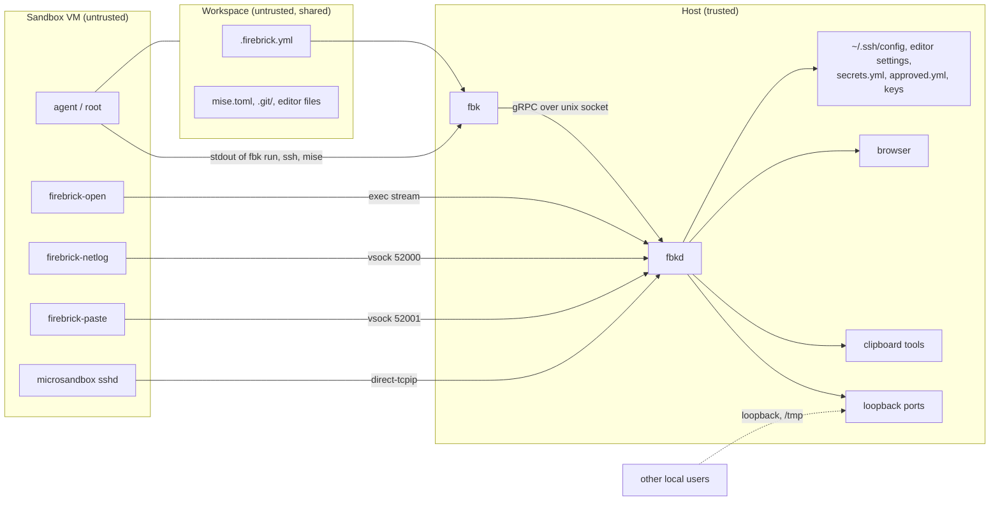

# Threat model

This document describes what firebrick protects, from whom, where the trust
boundaries are and which properties the code must keep. The
[security-reviewer agent](../../../.claude/agents/security-reviewer.md) reads it
before a review, so keep it in step with the code: a new channel between the
guest and the host, a new spec setting or a new file `fbkd` writes belongs here.

Accepted risks are described in
[Risks and technical debt](../11-risks-and-technical-debt.md); this document
summarizes them and links there instead of repeating them.

## Security goals

1. Code in a sandbox can't read or change host files outside the workspace and
   the mounts the user approved.
2. Code in a sandbox can't run code on the host.
3. Real secret values and private keys never enter a sandbox.
4. With `network.enforce: true`, a sandbox reaches only the hosts its approved
   rules allow.
5. A sandbox can't widen its own access: every setting that lets more cross the
   boundary needs the user's approval.
6. Other users on the host can't use a user's daemon, sandboxes, secrets or
   keys.

Firebrick doesn't try to keep the agent from misusing what the user gave it:
code in a sandbox with a GitHub token can push to the repositories the token
allows, and a sandbox with an allowed host can send data there.

## Assets

Ordered from most to least sensitive.

| Asset                                   | Where it lives                                                                    | Why it matters                                                                  |
| --------------------------------------- | --------------------------------------------------------------------------------- | ------------------------------------------------------------------------------- |
| Host code execution                     | The user's session                                                                | Everything else follows from it.                                                |
| Secret values                           | `secrets.yml`, microsandbox's database                                            | Tokens for GitHub, model APIs and cloud accounts.                               |
| Host SSH keys and `fbkd`'s sandbox keys | `~/.ssh`, `fbkd`'s data directory                                                 | Access to other machines and to every sandbox.                                  |
| TLS interception CA key                 | microsandbox's home, `$XDG_STATE_HOME/firebrick/msb/tls`                          | Decrypts the HTTPS traffic of every sandbox.                                    |
| Host files outside the workspace        | The user's home                                                                   | Source code, credentials, browser profiles.                                     |
| Host configuration that runs code       | `~/.ssh/config`, VS Code and Zed settings, shell and git config                   | A planted directive runs on the user's next `ssh` or editor start.              |
| Approved settings                       | `approved.yml` in the firebrick config directory                                  | Decide which mounts, rules and clipboard a sandbox gets.                        |
| Egress policy                           | The `firebrick.network` label, microsandbox's policy                              | Keeps data from leaving to hosts the user didn't allow.                         |
| Network records and logs                | `$XDG_STATE_HOME/firebrick/network/<sandbox>.json`, `fbkd.log`                    | Built from guest events and guest-chosen names; hold host paths and host names. |
| Host clipboard                          | The desktop session                                                               | Holds passwords and tokens copied for other purposes.                           |
| Host loopback services                  | Ports on `127.0.0.1` and `::1`                                                    | Dev servers, databases and agents that trust local callers.                     |
| The workspace                           | The mounted host directory                                                        | The agent may change it, but the user reviews it on the host.                   |
| Release artifacts                       | GitHub releases, crates.io, `ghcr.io/wmeints/firebrick-base`, the install scripts | Run on every user's host or in every sandbox.                                   |

## Adversaries

| Adversary                               | Capabilities                                                                                                                                                                                                                                                             | In scope                                                                  |
| --------------------------------------- | ------------------------------------------------------------------------------------------------------------------------------------------------------------------------------------------------------------------------------------------------------------------------ | ------------------------------------------------------------------------- |
| **The code in the sandbox**             | Runs anything as `agent` and, through passwordless `sudo`, as root in the guest. Controls every file in the workspace, every byte the guest sends to `fbkd`, the guest's network traffic, its processes and the network logger. Can keep running while the user is away. | Yes, the primary adversary.                                               |
| **Content the agent reads**             | A cloned repository, an issue, a web page or a package that injects instructions into a well-meaning agent. Gets the same capabilities as the code in the sandbox.                                                                                                       | Yes, treat as the code in the sandbox.                                    |
| **A malicious repository**              | Ships a `.firebrick.yml`, `mise.toml`, `.git/` and editor files that the user runs `fbk start` on, before any agent ran.                                                                                                                                                 | Yes.                                                                      |
| **Another local user**                  | Unprivileged account on the same host. Can connect to loopback ports, race on files in the shared temp dir and bind sockets there first.                                                                                                                                 | Yes.                                                                      |
| **A network attacker**                  | Sits between the host and a registry, apt repository or download server.                                                                                                                                                                                                 | Partly: transport security and checksums should stop them.                |
| **A compromised upstream**              | A crate, the Ubuntu base image, the mise or Docker apt repository, a GitHub action or microsandbox itself ships malicious code.                                                                                                                                          | Partly: pinning, audits and the release gate reduce it, but can't stop it |
| **Malware running as the host user**    | Reads and writes everything the user can.                                                                                                                                                                                                                                | No.                                                                       |
| **The user acting on purpose**          | Approves a change, passes `--yes`, mounts their home.                                                                                                                                                                                                                    | No, but warnings must make the consequence clear.                         |
| **A microsandbox or hypervisor escape** | A flaw in libkrun, the guest kernel or microsandbox's host side.                                                                                                                                                                                                         | No, unless firebrick configures microsandbox in a way that weakens it.    |

## Trust boundaries

The boundary runs between the guest, together with the workspace, and the host.
`fbk` and `fbkd` are trusted, but everything they receive from the guest or read
from the workspace is attacker-controlled. A second boundary separates the user
from other local users.

### Channels that cross the guest boundary

Each channel is an entry point. A new one needs an ADR, a row here and a check
in the security-reviewer agent.

| Channel                    | Direction                  | Host code                                   | What the guest controls                                                                                                                  | Guards                                                                                                  | ADR              |
| -------------------------- | -------------------------- | ------------------------------------------- | ---------------------------------------------------------------------------------------------------------------------------------------- | ------------------------------------------------------------------------------------------------------- | ---------------- |
| Workspace mount            | Both                       | microsandbox, `fbk`, `fbkd`                 | Every file, symlinks, `.firebrick.yml`                                                                                                   | Mounted read/write with owner `1000:1000`; spec settings that widen access need approval                | 0006, 0037       |
| `.firebrick.yml`           | Guest to host              | `crates/spec`, `crates/cli/src/approval.rs` | `name`, `image`, `init`, `mise`, `resources`, `volumes`, `ports`, `mounts`, `network`, `clipboard`; `name` and `image` are free text     | Validation in `firebrick-spec` for the structured fields; approval for `mounts`, `network`, `clipboard` | 0037, 0040       |
| URL relay                  | Guest to host              | `crates/daemon/src/open.rs`                 | URLs written to `/tmp/.firebrick/open.fifo`, the relay's stderr                                                                          | http(s) only, no local-network hosts, egress rules, rate limit, `strip_control`                         | 0026             |
| OAuth callback forwards    | Guest to host loopback     | `open.rs`, `forward.rs`                     | Which loopback port the host listens on, for how long                                                                                    | Only for loopback `redirect_uri`s with an explicit port, 10 minute idle limit, rate limit               | 0030             |
| Port forwards              | Host loopback to guest     | `forward.rs`                                | Which host loopback ports listen, through `ports` in the spec, applied on the next `fbk start` without approval, and the traffic on them | Loopback only, busy ports skipped                                                                       | 0019             |
| Network log                | Guest to host              | `netlog.rs`, `vsock.rs`                     | Every event line, connection count, timing                                                                                               | Each line parsed as untrusted, record bounded, control characters stripped before printing              | 0038, 0042       |
| Clipboard                  | Host to guest, on request  | `clipboard.rs`, `vsock.rs`                  | Requests on vsock `52001`, how often, how many connections                                                                               | Opt-in and approved, route only exists when created with it, size caps, 4 connections                   | 0048             |
| `fbk run` and SSH sessions | Guest to host terminal     | `session.rs`, `crates/cli/src/session.rs`   | Every byte of output, including escape sequences                                                                                         | None: passed through like `ssh` so TUIs work                                                            | 0044             |
| mise and other exec output | Guest to host logs, gRPC   | `mise.rs`, `sandboxes.rs`                   | stdout and stderr                                                                                                                        | `strip_control` before logs and status messages                                                         | 0017, 0044       |
| SSH tunnel                 | Host to guest              | `tunnel.rs`, `crates/cli/src/ssh.rs`        | The SSH server's responses                                                                                                               | Keys generated by `fbkd`; no agent forwarding                                                           | -                |
| Egress                     | Guest to network           | microsandbox, `network.rs`                  | All traffic, DNS queries, SNI, `Host` headers                                                                                            | microsandbox's policy, TLS interception for secret substitution                                         | 0018, 0021       |
| Secret placeholders        | Guest to network           | microsandbox, `secrets.rs`                  | Where the placeholder is sent                                                                                                            | Substituted only in headers to the secret's allowed hosts                                               | 0004, 0022, 0033 |
| Sandbox lifecycle          | Guest state to host action | `sandboxes.rs`                              | The root filesystem and Docker disk that snapshots and upgrades copy                                                                     | Labels and secrets come from the host, not from the guest                                               | 0021, 0041       |
| Image pull                 | Host to registry           | microsandbox, `pull.rs`, `sandboxes.rs`     | The registry the host contacts and the image it boots, through `image` in the spec, on `fbk start` and `fbk upgrade`                     | None beyond the VM boundary; changing `image` needs no approval                                         | 0005, 0037, 0041 |

### Host-side entry points for other local users

- The daemon socket, `$XDG_RUNTIME_DIR/fbkd.sock` or a fallback in the shared
  temp dir: mode `0600` and `SO_PEERCRED` in both directions.
- Loopback listeners for port and callback forwards: reachable by every local
  user, accepted in risks.
- Socket directories for vsock routes, which fall back to `/private/tmp` on
  macOS (ADR 0042), and every other path under a shared directory.
- Files `fbkd` and `fbk` create: a race on creation or an existing file with
  looser permissions.

## Threats and mitigations

Grouped by STRIDE category. The status of each threat is one of:

- **Mitigated:** the code has a guard; a change must keep it.
- **Accepted:** the docs accept the risk, in
  [Risks and technical debt](../11-risks-and-technical-debt.md) or a decision
  record; the code must still do what the docs say.
- **Check:** a guard exists, but it isn't verified or depends on microsandbox;
  reviewers verify it on every change that touches it.
- **Open:** a known gap that breaks an invariant, tracked in the linked issue.
  Reviewers don't report it again, but do report a change that makes it worse.

### Elevation of privilege: guest to host

| Threat                                                                                                                                            | Mitigation                                                                                                                        | Status                                                        |
| ------------------------------------------------------------------------------------------------------------------------------------------------- | --------------------------------------------------------------------------------------------------------------------------------- | ------------------------------------------------------------- |
| A sandbox name, path or other spec value injects a directive into `~/.ssh/config` (`ProxyCommand` through a newline) or into editor settings JSON | SSH host names come from `firebrick_utils::sanitize_label` or host-side labels; settings written with `jsonc-parser`, not by hand | Mitigated                                                     |
| The sandbox `name` from the spec reaches host paths, such as the vsock sockets and network records, before microsandbox validates it              | None yet: `firebrick-spec` and `fbkd` don't validate `name`                                                                       | Open, [#197](https://github.com/wmeints/firebrick/issues/197) |
| `fbk` or `fbkd` follows a symlink the agent planted in the workspace and reads or writes outside it                                               | None yet: `fbk init --force`, `fbk network` and `fbk port` write through a symlinked `.firebrick.yml`                             | Open, [#196](https://github.com/wmeints/firebrick/issues/196) |
| `fbkd` runs a host program with arguments the guest controls                                                                                      | `xdg-open`/`open` get one validated URL; clipboard tools get fixed arguments                                                      | Mitigated                                                     |
| A guest escape sequence in `fbk run` or `ssh` output reaches the terminal, such as OSC 52 or a terminal-specific exploit                          | None by design                                                                                                                    | Accepted                                                      |
| Spec text, such as a YAML error that quotes a key or the `image` reference, writes escape sequences to the terminal or `fbkd.log`                 | None yet: spec text isn't stripped                                                                                                | Open, [#200](https://github.com/wmeints/firebrick/issues/200) |
| Planted git hooks, `core.fsmonitor`, `.vscode/tasks.json`, `.envrc` or mise configs run when the user works in the workspace on the host          | User documentation warns                                                                                                          | Accepted                                                      |

### Tampering: the spec

| Threat                                                                                                | Mitigation                                                                  | Status    |
| ----------------------------------------------------------------------------------------------------- | --------------------------------------------------------------------------- | --------- |
| The agent adds a host path to `mounts`, widens `network`, turns off `enforce` or turns on `clipboard` | Approval in `approval.rs` before the sandbox is created or rules change     | Mitigated |
| A new spec setting that widens access isn't added to the approved settings                            | Review rule: every setting that lets more cross the boundary needs approval | Check     |
| The agent changes `image`, `init`, `mise`, `resources`, `volumes`, `ports` or `name`                  | None; these only change what runs inside the VM, or loopback listeners      | Accepted  |
| The agent removes `network` and the user recreates a sandbox that predates approvals                  | None                                                                        | Accepted  |
| The approved settings differ from what `fbkd` applies                                                 | The CLI converts mounts with the same `From<&Mount>` as the daemon          | Mitigated |

### Information disclosure

| Threat                                                                                                    | Mitigation                                                                                     | Status           |
| --------------------------------------------------------------------------------------------------------- | ---------------------------------------------------------------------------------------------- | ---------------- |
| A real secret value enters the guest, through the environment, a file, a log or a gRPC response           | The guest gets placeholders; errors never carry values; parse errors keep only line and column | Mitigated        |
| A secret value passed to `fbk secret set` on the command line shows in process listings and shell history | The help text recommends `--from-stdin`                                                        | Accepted         |
| A secret is sent to a host other than its allowed hosts                                                   | microsandbox substitutes only for allowed hosts, only in headers                               | Mitigated        |
| A sandbox gets another sandbox's scoped secrets, also a new sandbox with a removed sandbox's name         | Scoped secrets removed with their sandbox                                                      | Mitigated        |
| Host or `fbkd` private keys reach the guest                                                               | No agent forwarding; keys stay in `fbkd`'s data directory                                      | Mitigated        |
| The guest reads the host clipboard                                                                        | Opt-in, approved, size caps                                                                    | Accepted when on |
| Data leaves through an allowed host, a URL opened in the host browser, or DNS                             | None beyond the egress rules                                                                   | Accepted         |
| Secrets readable at rest by processes of the user                                                         | `0600` files                                                                                   | Accepted         |

### Tampering: egress policy

| Threat                                                                                                             | Mitigation                                      | Status   |
| ------------------------------------------------------------------------------------------------------------------ | ----------------------------------------------- | -------- |
| DNS tunnelling, SNI or `Host` mismatches, QUIC, IP literals, IPv6 with `init: false`, `host.microsandbox.internal` | microsandbox's policy, strict mode              | Check    |
| A window without the policy while `fbk network` recreates the sandbox                                              | Recreate from a snapshot with the new policy    | Check    |
| The agent hides traffic from the network log or sends false events                                                 | The log is a diagnostic aid, not an audit trail | Accepted |

### Spoofing and denial of service

| Threat                                                                                              | Mitigation                                                   | Status                                                        |
| --------------------------------------------------------------------------------------------------- | ------------------------------------------------------------ | ------------------------------------------------------------- |
| Another local user binds `fbkd.sock` in the temp dir first and receives `fbk secret set` values     | The CLI checks the peer's UID                                | Mitigated                                                     |
| Another local user connects to the daemon socket                                                    | `0600` and `SO_PEERCRED`                                     | Mitigated                                                     |
| Another local user plants a data or log directory in the temp dir                                   | Data and logs never fall back to the temp dir                | Mitigated                                                     |
| A sandbox claims a loopback port before a host service, or receives an OAuth code meant for another | Rate limit, idle limit                                       | Accepted                                                      |
| The guest floods `fbkd` with log events, clipboard requests, URLs or huge lines and exhausts memory | Bounded records, line limits, connection limits, rate limits | Check                                                         |
| An interrupted write leaves the user's `~/.ssh/config` empty                                        | None yet: `fbkd` truncates and rewrites it in place          | Open, [#198](https://github.com/wmeints/firebrick/issues/198) |

### Supply chain

| Threat                                                                                                       | Mitigation                                                                               | Status                                                        |
| ------------------------------------------------------------------------------------------------------------ | ---------------------------------------------------------------------------------------- | ------------------------------------------------------------- |
| A moved or hijacked action tag runs in CI or a release                                                       | Actions pinned to commit SHAs, enforced by the repository                                | Mitigated                                                     |
| A tool download in CI is swapped                                                                             | `mise.lock` checksums with `--locked`                                                    | Mitigated                                                     |
| A crate with a known vulnerability                                                                           | Daily `cargo audit`                                                                      | Mitigated                                                     |
| A release published without review                                                                           | `release` environment with a required reviewer                                           | Mitigated                                                     |
| An unpinned apt key in the `Dockerfile`, a retagged base image, or the default image pulled by a mutable tag | HTTPS and signed apt repositories; key fingerprints and the base image aren't pinned yet | Open, [#199](https://github.com/wmeints/firebrick/issues/199) |

## Invariants

The properties the code must keep. A change that breaks one is a finding, even
when no exploit is known yet.

1. **No guest data in host formats or paths without encoding.** A value from the
   spec, the guest or a workspace file reaches `~/.ssh/config`, editor settings,
   YAML or JSON files, or a host file system path, such as a socket or record
   named after the sandbox, only after validation against a strict allow-list of
   characters, or through a serializer.
2. **No guest or spec text on the host terminal or in logs without stripping**,
   except the interactive output of `fbk run` and `ssh`. This includes YAML
   errors that quote the spec. Use `firebrick_utils::strip_control`.
3. **No host program runs with guest-chosen arguments** beyond a URL that passed
   the checks in `open.rs`.
4. **Host code doesn't follow workspace symlinks.** The only workspace file the
   host reads is `.firebrick.yml`, and the only one it writes, from `fbk init`,
   `fbk network` and `fbk port`. The agent can replace it with a symlink to a
   host file, so reading and writing it must not reach a file outside the
   workspace.
5. **Every spec setting that widens access needs approval**, compared against
   `approved.yml` before the sandbox is created or the rules change. `--yes`
   prints the difference anyway.
6. **Guest-to-host channels are fixed by the host.** vsock routes, exec streams
   and labels are set by `fbkd` when it creates a sandbox, from the host's
   settings, never from the guest's state. A recreate or upgrade keeps the
   labels, not what the guest wrote.
7. **Every guest input is bounded**: line length, message size, connection
   count, rate and the size of anything `fbkd` keeps in memory or on disk.
8. **Real secret values never leave the host side of microsandbox**, and never
   appear in errors, logs, labels or gRPC responses.
9. **Listeners bind loopback only**, and sockets get mode `0600` and a peer
   check.
10. **Files with secrets, keys or approvals are created private**, through
    `firebrick_utils::write_private`, regardless of the umask or an existing
    file's mode, and never in a shared directory.

## Out of scope

- Malware that runs as the host user, and a compromised host.
- Escapes from libkrun, the guest kernel or microsandbox, unless firebrick
  configures them in a weaker way than the defaults.
- What the agent does inside the guest, including root through `sudo` and
  Docker.
- Misuse of access the user granted: an allowed host, a mounted directory, a
  secret for its allowed hosts, the shared clipboard.
- Windows, which has no release.
